# A2E Rénovation

## Guide d'utilisation et d'administration — V1

**Édition du 19 octobre 2026**  
Un site pour présenter les travaux, préparer une estimation et suivre chaque demande jusqu'au prochain échange.

Ce guide décrit les fonctions présentes dans la V1. Il s'adresse à la direction, à la personne qui traite les demandes et à celle qui prépare les prix et les publications. Les adresses commençant par `/` se placent après le domaine du site. Les captures proviennent de l'environnement local de préparation ; ses prospects et ses inspirations ne représentent pas une activité commerciale réelle.

Pour l'installation, les variables privées, la sauvegarde et la mise à jour, consulter le [guide de migration Docker](../migration-docker-premium.md). Pour le réglage du transport email, consulter aussi [Notifications email](../notifications-email.md). Les instructions de ces guides doivent être appliquées à la stack réellement déployée.

### Lire ce guide selon votre besoin

| Votre objectif | Aller à |
| --- | --- |
| Découvrir ce que le client peut faire | 1. L'expérience côté client |
| Comprendre le simulateur et son PDF | 2. Préparer une estimation |
| Ajouter un besoin particulier ou demander un rappel | 3. Demande sur mesure |
| Prendre en main l'administration | 4. Se connecter et s'orienter |
| Traiter les demandes et les relances | 5. Dossiers clients et CRM |
| Modifier les prix ou charger un catalogue | 6. Catalogue de prix |
| Préparer une cotation personnalisée | 7. Atelier de cotation |
| Publier un chantier, des photos ou un avis | 8. Réalisations et avis |
| Configurer les destinataires et lire les envois | 9. Site et notifications |
| Comprendre les chiffres et exporter | 10. KPI, journal et exports |
| Organiser la gestion courante | 11. Routines d'exploitation |
| Résoudre un incident ou connaître les limites | 12. Dépannage et périmètre V1 |

## 1. L'expérience côté client

La vitrine présente A2E, les métiers proposés et les moyens de démarrer un projet. Elle est utilisable sur téléphone, tablette et ordinateur. Le visiteur peut téléphoner, composer ses travaux ou présenter directement un besoin particulier.

*L'accueil conduit vers une estimation ou un échange avec A2E. Les coordonnées affichées doivent être celles validées par l'entreprise.*

| Page | Ce que le visiteur peut y faire |
| --- | --- |
| `/` | Comprendre l'offre, ouvrir le premier budget express et rejoindre le simulateur ou le contact. |
| `/services` | Choisir un métier et consulter sa page de présentation, ses prestations et ses points techniques. |
| `/tarifs` | Rechercher une référence et lire son unité, sa fourchette, son descriptif et sa gamme indicative. |
| `/simulateur` | Combiner plusieurs métiers, renseigner quantités et options, lire le budget puis enregistrer un dossier avec PDF. |
| `/contact` | Décrire un projet sur mesure, ajouter des remarques et demander un rappel. |
| `/realisations` | Consulter les fiches publiées, les images et vidéos, le diaporama et les comparaisons disponibles. Les inspirations sont présentées comme telles. |
| `/aides` | Explorer des pistes selon le foyer et l'année, lire les limites et ouvrir les sources officielles. |
| `/equipe` | Consulter la présentation de l'équipe publiée dans le site. |

Les pages de services et de zones, les métadonnées de partage et le sitemap soutiennent la visibilité du site. Elles ne constituent pas une garantie de position dans Google. La rubrique **Site & notifications** donne accès au sitemap et aux services Google utiles ; la vérification Search Console est une configuration du serveur.

### Aides 2026 et préparation 2027

Le module `/aides` sert à préparer un échange, sans annoncer un droit acquis. En mode 2026, le visiteur peut saisir le nombre de personnes et la somme des revenus fiscaux de référence pour situer un profil en Île-de-France. Cette saisie reste dans la page et n'est pas transmise avec le dossier de travaux.

Le mode 2027 présente les textes et points à confirmer documentés dans le module. Il n'invente pas un barème annuel absent et n'extrapole pas les montants 2026. Les aides ne sont pas soustraites au budget du simulateur ou aux cotations.

La page affiche la date de vérification du contenu et les liens vers l'Anah, France Rénov', Service Public et les textes officiels utilisés. Avant d'utiliser ces informations dans un dossier réel, ouvrir les sources actuelles et faire confirmer les conditions propres au logement, aux travaux et à l'entreprise. Cette V1 ne dépose aucun dossier d'aide et ne certifie aucune qualification RGE d'A2E.

## 2. Préparer une estimation

Le simulateur suit quatre étapes : **Travaux → Précisions → Budget → Votre PDF**. Un seul dossier rassemble les métiers retenus. Le budget se recalcule lorsque les quantités et les choix changent.

### Étape 1 — Travaux

Sélectionner un ou plusieurs métiers : fenêtres, isolation, électricité, plomberie, chauffage et air, cuisine et bain, toiture ou projet global. Il est possible de revenir à cette étape pour ajouter ou retirer un métier. Un projet global et des postes détaillés peuvent se recouper : vérifier les prestations retenues pour éviter de chiffrer deux fois un même travail.

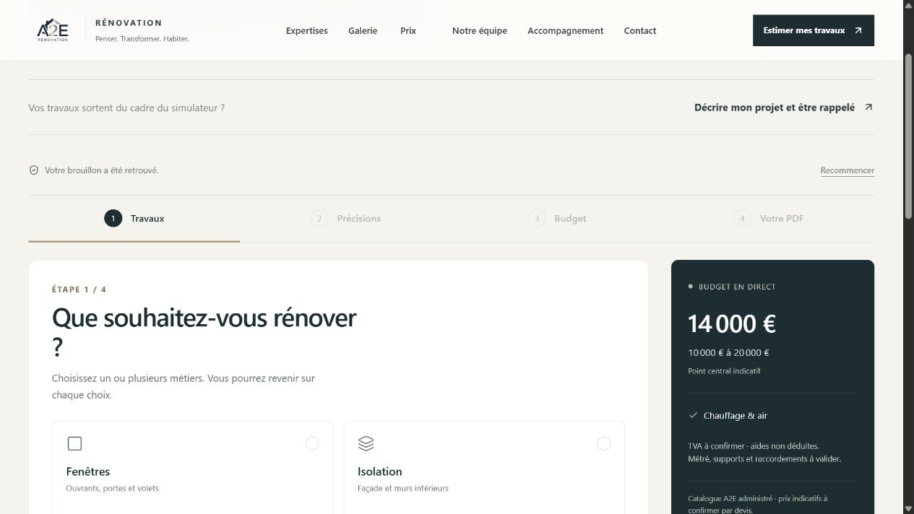

*Les métiers sélectionnés restent accessibles dans la navigation du projet. Une quantité est propre à son équipement ou à son poste.*

### Étape 2 — Précisions

Utiliser les onglets des métiers pour passer d'un lot à l'autre. Le retour conserve les réglages. Les champs disponibles dépendent du métier choisi.

| Métier | Précisions prévues dans la V1 |
| --- | --- |
| Fenêtres et menuiseries | Une ligne par configuration : fenêtre, porte-fenêtre, baie ou porte d'entrée ; matériau, quantité, dimensions en centimètres, ouverture, pose et volet. Ajouter, dupliquer ou supprimer une configuration. |
| Isolation | Surface et solution d'isolation, matériaux et hypothèses techniques proposées par le formulaire. |
| Électricité | Quantités de prises, éclairages et équipements, composition ou pack choisi et tableau distinct lorsqu'il est nécessaire. Un tableau complet n'est pas ajouté à tout petit besoin. |
| Plomberie | Équipements et quantités, fourniture et pose selon les variantes proposées ; les raccordements sont à confirmer. |
| Cuisine et salle de bain | Pièce et surfaces concernées, équipements et finitions. La surface au sol n'est pas la surface de tous les murs. |
| Chauffage et air | Choix PAC, ventilation ou eau chaude et informations nécessaires à une première hypothèse. Le dimensionnement final reste une étude technique. |
| Toiture et projet global | Surfaces, prestations et options proposées, avec contraintes à confirmer. |

Les options du catalogue retenues apparaissent séparément au budget. Renseigner aussi **Lieu, accès et calendrier** : ville, code postal si connu, difficulté d'accès et délai souhaité. Ces choix peuvent modifier le montant ; les hypothèses sont reprises dans le récapitulatif.

### Étape 3 — Budget

Lire la fourchette basse, centrale et haute, puis chaque ligne : libellé, quantité, unité et montant. Ouvrir **Prestation et hypothèses** pour consulter le contenu, les exclusions et la gamme indicative. Les hypothèses de chantier et la durée indicative sont consultables dans le détail.

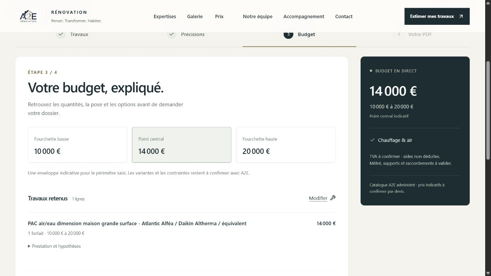

*Le point central est une hypothèse de budget. Une fourchette basse/haute ne représente pas une remise commerciale.*

Une référence de matériau indique une gamme ou un exemple à confirmer. Elle n'est pas une réservation de stock ni un engagement fournisseur. Les métrés, supports, accès, raccordements, TVA et références exactes restent à valider par A2E avant un devis contractuel.

**Exemple de lecture :** pour quatre prises neuves, contrôler que la quantité est quatre, que le descriptif correspond aux liaisons prévues et qu'aucun tableau ou autre équipement non demandé ne figure dans le panier. Si les supports ou les distances sortent du descriptif, compléter la demande et demander une étude.

### Étape 4 — Votre PDF

Le visiteur renseigne son nom, son téléphone, son email et l'accord pour être recontacté. Dans ce parcours, email et téléphone sont requis. Il peut ajouter une description, des remarques et une préférence de rappel. Les travaux décrits en texte libre sont transmis à l'équipe mais **ne sont pas chiffrés automatiquement** dans le total.

Après validation, le serveur recalcule les montants, enregistre le dossier et prépare son PDF. Celui-ci regroupe les lignes et hypothèses du projet avec une référence. Conserver le fichier et la référence pour le prochain échange.

Si le dossier est enregistré mais que le téléchargement échoue, utiliser **Télécharger à nouveau le PDF** sur l'écran courant. Cela reprend le PDF du dossier conservé. Éviter de soumettre une nouvelle demande pour obtenir simplement le même document. Si le problème continue, communiquer la référence à A2E.

Une erreur d'email ne doit pas bloquer l'enregistrement ni le téléchargement du PDF. Le message de réussite du formulaire ne prouve pas qu'un email a été reçu par l'équipe. Le journal admin permet de vérifier la tentative.

### Brouillon et reprise

Les choix de travaux sont conservés dans le stockage local du navigateur lorsqu'il est disponible. Le brouillon est propre à cet appareil et à ce navigateur ; il ne constitue pas une sauvegarde de dossier en base. Les coordonnées et textes libres de la dernière étape ne sont pas inclus dans ce brouillon de travaux.

Si un budget express arrive alors qu'un brouillon existe, le site propose de conserver le brouillon ou d'appliquer le nouveau premier budget. **Recommencer** demande une confirmation avant de remplacer le projet en cours. Un navigateur privé, un nettoyage du stockage ou un autre appareil peut ne pas retrouver le brouillon.

## 3. Demande sur mesure et rappel

Le formulaire `/contact` permet de présenter un projet qui ne rentre pas dans les postes chiffrés, ou de démarrer par un échange humain. Il crée un dossier sans inventer de montant ni de budget.

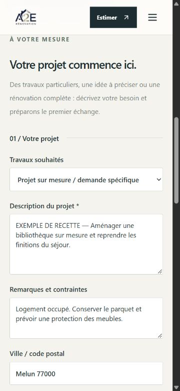

*La description expose le besoin ; les remarques précisent les contraintes ; la disponibilité est une préférence de rappel, pas un rendez-vous confirmé.*

1. Choisir **Projet sur mesure / demande spécifique**, un métier ou **Rénovation globale / plusieurs métiers**.
2. Décrire le projet : pièces concernées, objectif, travaux envisagés et dimensions connues. La description est obligatoire, de 10 à 12 000 caractères.
3. Ajouter si utile des **Remarques et contraintes**, jusqu'à 2 000 caractères : accès, occupation du logement, délai, équipement à conserver ou question particulière.
4. Renseigner la ville ou le code postal si connu.
5. Garder ou décocher **Je souhaite être rappelé**. Avec le rappel, un téléphone est obligatoire ; l'email peut rester vide. Une préférence de disponibilité de 160 caractères maximum peut être ajoutée.
6. Renseigner le nom et au moins un moyen de réponse. Sans demande de rappel, un email ou un téléphone suffit.
7. Donner l'accord explicite de recontact, puis envoyer. Conserver la référence affichée.

L'équipe retrouve la description, les remarques et la préférence de rappel dans le dossier CRM. Un créneau reste à convenir ; la V1 ne réserve pas automatiquement un rendez-vous. Pour demander un rappel après une estimation, les mêmes précisions sont disponibles à la dernière étape du simulateur, avec ses coordonnées requises pour le PDF.

## 4. Se connecter et s'orienter dans l'administration

Ouvrir `/admin`. En l'absence de session, le site présente `/admin/connexion`. Utiliser les identifiants configurés pour cet hébergement. La V1 utilise **un compte administrateur configuré sur le serveur** ; elle ne fournit pas encore de comptes individuels avec rôles auditeur ou opérateur.

L'identifiant et le mot de passe se gèrent par les variables privées `ADMIN_EMAIL` et `ADMIN_PASSWORD`. `AUTH_SECRET` signe les sessions. Ils ne se modifient pas dans la page des destinataires et ne doivent jamais figurer dans une capture, un CSV, un PDF ou le dépôt Git. La session dure huit heures ; se déconnecter explicitement sur un poste partagé. Des échecs répétés peuvent temporairement limiter une nouvelle tentative de connexion.

Sur ordinateur, choisir une rubrique dans le menu latéral. Sur téléphone, utiliser **Rubrique de gestion**. Le lien **Voir le site** ouvre la vitrine et **Nouvelle cotation** conduit à l'atelier de préparation des prix.

| Rubrique | Utilisation principale |
| --- | --- |
| Activité & conversions | Lire les demandes enregistrées, les prochaines actions et le parcours mesuré. |
| Dossiers clients | Rechercher, créer, qualifier et suivre les dossiers. |
| Catalogue de prix | Consulter, modifier et importer le référentiel commun. |
| Réalisations & avis | Préparer les fiches, les médias et les avis publiables. |
| Site & notifications | Modifier téléphone et réseaux, destinataires et préférences de notification. |
| Journal & exports | Examiner les dernières modifications, les tentatives d'envoi et exporter les contacts consentis. |

### Une sauvegarde confirmée se relit

Les formulaires demandent au serveur d'enregistrer puis de relire les données. Attendre la confirmation complète avant de changer de rubrique. Si l'envoi a réussi mais que la relecture n'est pas confirmée, ne pas répéter aveuglément l'action : recharger les données enregistrées et comparer. La saisie locale peut rester présente pour la vérification, sans être une preuve de sauvegarde.

## 5. Dossiers clients et CRM

Ouvrir **Dossiers clients** (`/admin#pipeline`). Le CRM rassemble les demandes du simulateur, les contacts directs et les prospects saisis par l'équipe. Un dossier correspond à un projet ; deux demandes d'une même personne ne sont pas fusionnées automatiquement.

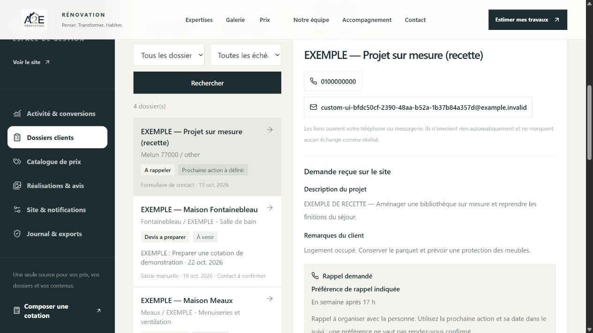

*Une prochaine action et son échéance organisent le travail. L'historique consigne ce que l'équipe déclare avoir fait.*

### Rechercher et qualifier

La recherche porte sur nom, entreprise, coordonnées, ville et travaux. Combiner les filtres de source, statut, accord de contact et échéance pour préparer une file de traitement. La liste est paginée par vingt dossiers. Sur mobile, ouvrir une fiche remplace la liste ; le retour permet de reprendre la file filtrée.

Dans une demande web, lire les informations du projet, l'estimation éventuelle, la description, les remarques et la demande de rappel. Relever les questions manquantes avant de contacter la personne : métrés, photos, budget envisagé, accès ou délai réel. Le montant d'une estimation indicative n'est ni une vente signée ni du chiffre d'affaires.

### Créer un prospect manuellement

Utiliser **Ajouter un prospect**. Renseigner un nom ou une entreprise, au moins un email ou un téléphone, le type de projet et la source : saisie manuelle, téléphone, recommandation, réseau, salon ou partenaire. Ville et budget peuvent rester inconnus. L'accord de contact est faux par défaut : le renseigner selon l'autorisation réellement recueillie et conserver sa preuve dans l'organisation A2E.

Cette création n'envoie aucun email, ne fabrique pas de PDF et n'ajoute aucun événement d'acquisition web. Une nouvelle tentative identique après une réponse incertaine réutilise l'identifiant de création ; elle ne doit pas servir à fabriquer plusieurs dossiers. Si le formulaire indique qu'un dossier existe déjà avec cette demande, ouvrir celui-ci avant de continuer.

### Utiliser les statuts

| Statut | Quand l'utiliser |
| --- | --- |
| Nouveau | Demande enregistrée, à qualifier. |
| À rappeler | Échange ou rappel à préparer. |
| Visite à planifier | Une visite doit être organisée. |
| Devis à préparer | Les éléments doivent être chiffrés ou vérifiés. |
| Devis envoyé | L'équipe a transmis le document ; le changement de statut est manuel. |
| Signé | L'équipe a constaté la signature. |
| Gagné | Le dossier est considéré gagné selon le suivi A2E. |
| Perdu | Le projet est clos sans suite commerciale. |

Ces statuts ne déclenchent pas de facturation, de signature électronique ou d'envoi automatique au client. **Signé**, **Gagné** et **Perdu** sortent les dossiers de la file d'échéances active tout en conservant leur consultation.

### Préparer les relances

Saisir ensemble une **prochaine action** et une **date** : par exemple « Confirmer les métrés cuisine » et la date prévue. La date est interprétée dans le fuseau **Europe/Paris**. Les files distinguent retard, aujourd'hui, à venir et action à définir. Elles ne constituent pas un agenda partagé avec réservation de créneau.

Les liens de téléphone et de messagerie ne sont proposés que lorsque l'autorisation de contact est confirmée. Ils ouvrent l'application de l'opérateur. Ils n'envoient pas le message dans A2E et n'inscrivent pas automatiquement l'échange comme réalisé.

Après un appel, un email, une visite ou une note interne, consigner le type, la date et le compte rendu. Utiliser **Action réalisée** pour terminer l'action courante après avoir enregistré les autres changements ; une trace est ajoutée et l'action est effacée. Prévoir ensuite la prochaine étape si le dossier reste ouvert.

### Conflit de modification

Si un autre onglet a changé le dossier, une sauvegarde obsolète est refusée avec un conflit **409**. Recharger la version enregistrée, comparer les changements et reprendre la saisie utile. Ne pas recopier intégralement une ancienne fiche au risque d'annuler une mise à jour récente. Les historiques déjà enregistrés restent conservés ; la V1 ne propose pas de suppression de dossier ou d'activité dans l'interface CRM.

### Passer à une cotation

L'action de cotation du dossier ouvre `/admin/cotations?lead=<identifiant>` et reprend les coordonnées et la ville. Composer les lignes de prix dans l'atelier : un ancien total global n'est pas transformé automatiquement en prix unitaire. Les cotations restent des documents distincts du suivi du dossier ; leurs statuts se gèrent manuellement.

## 6. Catalogue de prix

Le catalogue alimente les tarifs publics, le simulateur et les nouvelles lignes de cotation. L'aperçu de préparation contient **80 références, dont 25 postes détaillés à la carte**. Le nombre présent sur un hébergement existant peut être différent : la mise à jour ne remplace pas automatiquement les prix de l'entreprise.

La base initiale est un référentiel de départ, mêlant hypothèses et repères publics documentés. Aucune licence Batiprix/BatiChiffrage ni grille négociée fournisseur A2E n'est intégrée. Les comparaisons sont détaillées dans [Catalogue 77 : sources et limites](../catalogue-77-2026-10.md). Les tarifs ne se synchronisent pas automatiquement avec le marché.

### Modifier ou ajouter une référence

Dans **Catalogue de prix** ou `/admin/prix`, rechercher la référence et filtrer par corps d'état. Vérifier le libellé, l'unité, les trois prix unitaires, la TVA indicative, la référence ou gamme et le descriptif. Le descriptif doit préciser les fournitures, la pose, la dépose, les limites de liaison, les reprises et les exclusions utiles.

Les prix acceptent les centimes et doivent respecter **0 ≤ bas ≤ central ≤ haut**. Une nouvelle référence possède une clé unique en minuscules, chiffres et traits de soulignement, par exemple `depose_carrelage`. Cette clé identifie une prestation : ne pas réutiliser celle d'un ancien poste pour une prestation différente.

**Ajouter une référence ne crée pas automatiquement un nouveau formulaire métier dans le simulateur.** Elle est disponible dans le référentiel et l'atelier de cotation ; son utilisation dans un calcul public dépend des postes et des options déjà raccordés au formulaire.

### Importer un fichier de prix

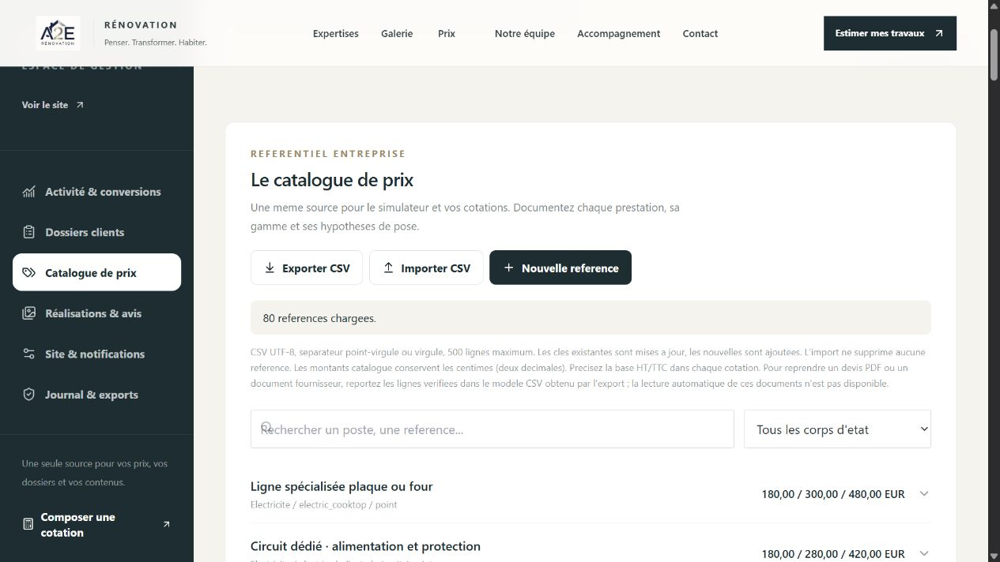

*L'aperçu distingue ajouts et mises à jour. Une clé existante reprend également l'unité, la TVA, la gamme et le descriptif du fichier.*

1. **Exporter CSV** avant toute modification importante et conserver le fichier daté.
2. Utiliser l'export comme modèle, avec les dix colonnes : `key;label;category;unit;low;mid;high;vatRate;reference;description`.
3. Préparer le fichier en UTF-8. Le séparateur point-virgule convient à Excel français ; la virgule est aussi acceptée. Conserver les en-têtes et les clés exactes.
4. Choisir **Importer CSV**. Limites : **500 lignes et 500 Ko**. Lire les erreurs éventuelles puis contrôler **toutes** les lignes de l'aperçu.
5. Choisir **Appliquer l'import**, attendre la relecture complète et rechercher plusieurs références importantes.
6. Vérifier ensuite un exemple réel dans le simulateur et une nouvelle cotation.

L'import applique les lignes en une transaction : les clés connues sont mises à jour et les nouvelles ajoutées. Il ne supprime aucune référence et ne réactive pas une ancienne référence désactivée. Les taux indicatifs acceptés sont 5,5 %, 10 % et 20 % ; leur applicabilité doit être vérifiée par l'entreprise.

Un devis PDF, une photo de tarif ou un document fournisseur n'est pas lu automatiquement. Reprendre manuellement les lignes vérifiées dans le modèle CSV : **aucun OCR ni extraction automatique de tarifs n'est disponible**.

### Valider la cohérence économique

Pour un tarif de production, déterminer la base HT/TTC, l'achat réel, le temps de pose, les consommables, la dépose, le déplacement éventuel, les contraintes et la marge. Comparer des périmètres identiques. Un prix de fourniture en magasin ne valide pas un prix posé ; une pose sur attente existante ne couvre pas la création d'un réseau.

Les lignes déjà copiées dans une cotation conservent leurs valeurs : une correction du catalogue ne réécrit pas silencieusement un document préparé. Si ce document doit évoluer, ouvrir la cotation et y modifier les postes explicitement.

## 7. Atelier de cotation

Ouvrir **Nouvelle cotation** ou `/admin/cotations`. Cet atelier permet à l'équipe de préparer une étude détaillée à partir du catalogue ou de postes libres, y compris un besoin sur mesure absent du simulateur.

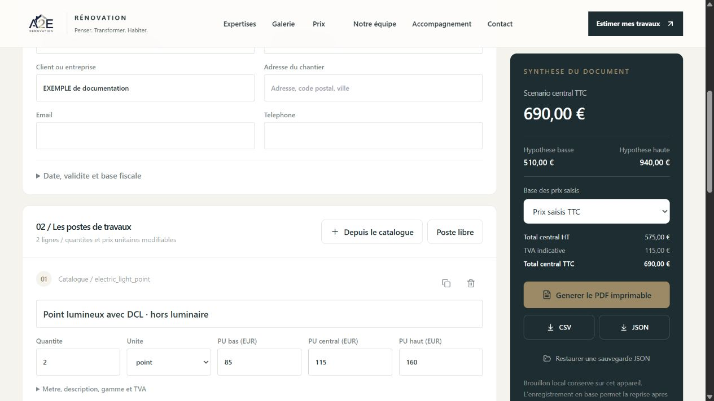

*La base fiscale doit être confirmée avant remise au client. Le statut « Remis au client » est déclaré par l'équipe.*

### Composer le document

1. Renseigner l'intitulé, le numéro, le client, l'adresse et les coordonnées.
2. Vérifier la date, la validité et la **base des prix saisis** : à confirmer, HT ou TTC. La base est indéterminée par défaut pour éviter une conversion fiscale implicite.
3. Ajouter des lignes **Depuis le catalogue** ou créer un **Poste libre**.
4. Modifier quantité, unité, prix unitaires bas/central/haut, contenu, exclusions, gamme et TVA. Dupliquer une ligne si les configurations se ressemblent ; supprimer celles qui ne s'appliquent plus.
5. Pour une ligne en m², activer si utile largeur × hauteur × nombre de surfaces. Ces dimensions ne sont pas appliquées à une unité ou à un point.
6. Ajouter les réserves et points à confirmer. La limite du document est de **150 lignes**.
7. **Enregistrer** puis attendre la confirmation de relecture en base.

Les trois hypothèses restent visibles dans la synthèse et les exports. Si la base est HT ou TTC, la TVA indicative est calculée par ligne. Avec une base à confirmer, le document n'invente pas de TVA ajoutée ou déduite. Vérifier taux et conditions avant transmission.

### Appliquer une remise

La remise de cotation est facultative, à 0 % par défaut, de 0 à 15 %. Un motif est obligatoire dès qu'elle est positive, par exemple un regroupement de lots validé. Elle est appliquée une seule fois, ligne par ligne avec arrondi au centime. Le montant avant remise, la réduction et le net restent visibles.

Cette remise n'est pas automatiquement cumulée avec l'**avantage signature** configuré pour le simulateur public. Contrôler les conditions commerciales retenues pour éviter de promettre deux avantages différents.

### Enregistrer, reprendre et transmettre

Le brouillon de cotation est conservé localement sur le navigateur utilisé. **Enregistrer en base** permet de retrouver le document sur un autre appareil ; la liste présente les cent cotations modifiées le plus récemment. Ouvrir un autre document peut remplacer le brouillon : enregistrer ou exporter avant de confirmer.

| Action | Résultat |
| --- | --- |
| Générer le PDF imprimable | Produit un document avec montants recalculés côté serveur, détail, date, validité, réserves et mention indicative. |
| CSV | Exporte les lignes, hypothèses, remise et totaux pour lecture dans un tableur. |
| JSON | Exporte le document complet pour restauration dans l'atelier. |
| Restaurer une sauvegarde JSON | Valide le fichier et remplace le brouillon après confirmation lorsque nécessaire. Enregistrer ensuite en base. |
| Statut Brouillon / À vérifier / Remis au client | Classe manuellement le document. Ne l'envoie pas au client. |

La V1 ne comporte pas de facturation, encaissement ni signature électronique. Le PDF préparé reste une cotation indicative à vérifier et à transmettre par l'équipe. Les aides ne sont pas déduites automatiquement.

## 8. Réalisations, médias et avis

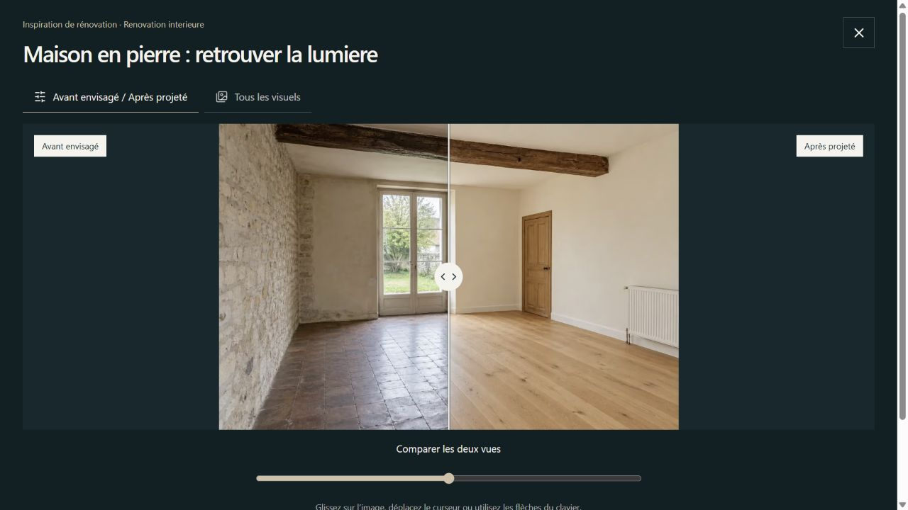

*Les trois inspirations proposent des intentions de rénovation. Les vraies réalisations A2E se publient depuis leurs propres fiches de chantier.*

### Créer et publier un chantier

Dans **Réalisations & avis**, utiliser **Nouvelle réalisation**. Renseigner titre, ville ou zone, type de travaux et description. Durée et budget public sont facultatifs : laisser vide lorsqu'ils ne sont pas validés. Ajouter jusqu'à huit mots-clés pour faciliter la lecture.

**Créer le brouillon** enregistre la fiche sans la publier. Ajouter ensuite les photos et vidéos dans **Photos & vidéos**, puis ouvrir **Aperçu enregistré**. Cet aperçu utilise les valeurs sauvegardées, pas une saisie non enregistrée. Au moins une photo est nécessaire pour publier.

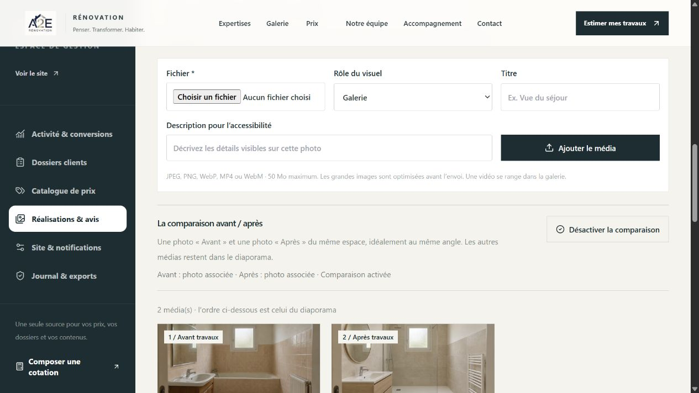

*Créer la fiche, ajouter les médias, vérifier l'aperçu, puis publier. Sur une fiche déjà publiée, les changements de médias deviennent visibles après sauvegarde.*

Les fiches préparées avec des visuels illustratifs sont présentées au public comme **Inspirations**. Leur provenance reste visible dans l'éditeur authentifié. Pour documenter un chantier réellement exécuté, créer une nouvelle fiche avec ses propres photos et informations vérifiables. Les visuels de préparation ne deviennent pas des preuves de chantier après un changement de titre.

### Organiser les photos et le diaporama

L'envoi accepte JPEG, PNG, WebP, MP4 et WebM, jusqu'à **50 Mo par fichier**. Les grandes images sont optimisées avant l'envoi. Le proxy d'hébergement doit lui aussi autoriser la taille nécessaire ; une limite du proxy peut refuser un fichier pourtant accepté par le formulaire.

Choisir la bonne fiche, le rôle du visuel, un titre et une description d'accessibilité. Après envoi et relecture, utiliser les flèches pour régler l'ordre, **Couverture** pour sélectionner la photo principale et **Description** pour corriger les textes. Les vidéos restent dans la galerie et ne servent ni de couverture ni de comparaison avant/après.

Pour la comparaison, associer une photo **Avant travaux** et une photo **Après travaux** du même espace, puis **Confirmer : c'est le même espace**. Les autres médias restent disponibles dans le diaporama. Pour les inspirations, les vues publiques sont libellées **Avant envisagé** et **Après projeté**.

Privilégier un angle et une hauteur de prise de vue identiques avant/après, une lumière naturelle régulière et des plans de détail utiles. Ne publier que des images autorisées, sans documents personnels ou éléments identifiants non nécessaires. Le [guide photo des chantiers](../guide-photos-chantiers.md) donne une méthode de prises de vue à reproduire.

**Passer en brouillon** retire la fiche de la galerie publique. La suppression d'un média demande confirmation ; supprimer la dernière photo d'une fiche publiée est refusé tant que la fiche reste publiée. La V1 ne génère pas automatiquement de nouvelles images de chantier depuis l'admin.

### Publier un avis réel

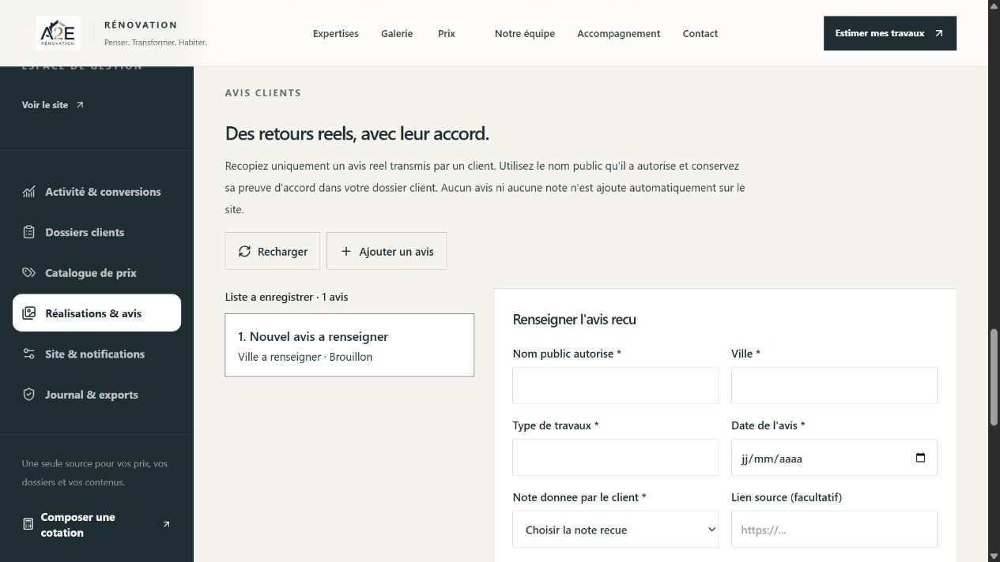

*La note, le texte et l'accord doivent provenir du client. Les changements restent locaux jusqu'à « Enregistrer les avis ».*

Saisir le nom public autorisé, la ville, les travaux, la date, la note réellement reçue de 1 à 5 et le texte exact. Un lien source peut être ajouté. Confirmer l'accord de publication, conserver sa preuve dans le dossier A2E puis choisir la publication.

Les ajouts, corrections et suppressions attendent **Enregistrer les avis**. Une suppression peut être annulée avant cet enregistrement. En cas de conflit 409, relire la version enregistrée avant de reprendre les modifications.

Sans avis publié avec accord confirmé, le bloc public est masqué. La V1 ne crée aucun avis, aucune note moyenne ni aucun compteur fictif. La case admin atteste un accord recueilli par l'équipe ; elle ne recueille pas automatiquement cet accord auprès du client.

## 9. Site, coordonnées et notifications

### Ce qui se règle dans l'admin

Ouvrir **Site & notifications**. Modifier le téléphone public, les liens Instagram, Facebook et LinkedIn, le fournisseur d'envoi, les destinataires, les événements de notification et les préférences de mesure. Un lien social vide peut rester vide ; n'utiliser que les comptes de l'entreprise.

L'**avantage signature** est un réglage commercial de 0 à 15 %, avec une validité de 1 à 60 jours. Une valeur à 0 % reste désactivée. Vérifier les conditions et la présentation publique après tout changement.

Le logo et l'identité générale, l'adresse email publique, les pages de services et les textes éditoriaux ne disposent pas d'un éditeur universel dans cette V1. Leur évolution relève des fichiers de configuration et d'une livraison du site. L'**adresse historique** de notification n'est pas l'adresse email publique du formulaire et ne remplace pas la liste des destinataires.

### Choisir les destinataires

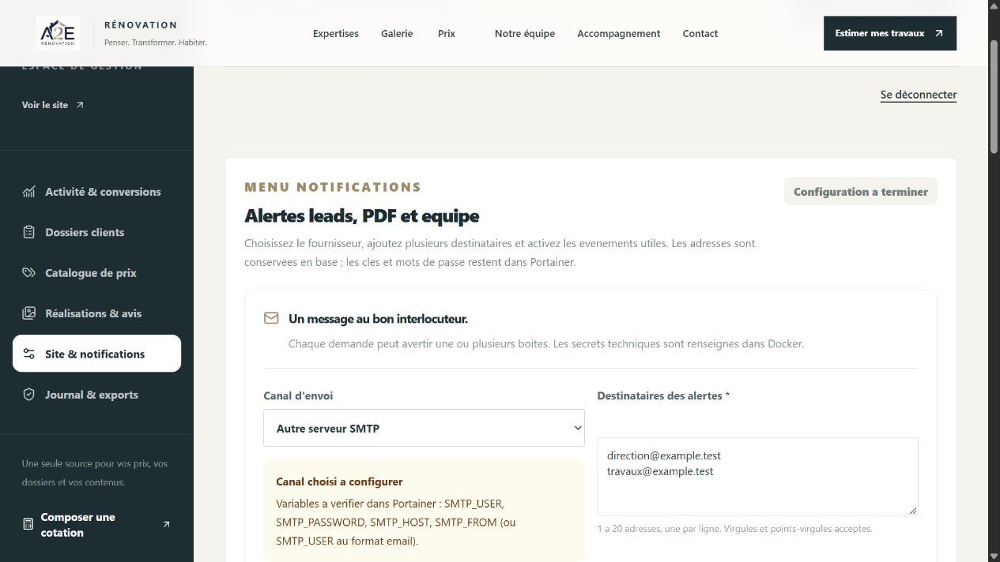

*Les adresses se règlent dans l'admin. Les mots de passe et clés restent dans l'environnement Docker ; le statut ne montre pas leur valeur.*

1. Choisir le canal : **Brevo API**, **OVH SMTP**, **Gmail SMTP** ou **Autre serveur SMTP**.
2. Renseigner **1 à 20 adresses** dans **Destinataires des alertes**, une par ligne. Virgules et points-virgules sont aussi acceptés. Une liste invalide est refusée ; elle n'est pas envoyée partiellement après suppression silencieuse d'une adresse mal saisie.
3. Activer ou désactiver les événements **nouvelle demande** et **pré-devis PDF** selon l'organisation choisie.
4. Enregistrer et attendre la relecture en base.
5. Faire configurer le transport privé sur l'hébergement, redéployer puis vérifier la réception d'une demande de test autorisée.

Les notifications avertissent les destinataires internes configurés. Elles ne constituent pas une campagne de relance client ni un accusé de réception garanti au prospect. Un projet peut générer une notification de demande puis une notification de PDF si les deux événements sont activés.

### Variables privées et contrôle de réception

Pour SMTP, l'opérateur configure `SMTP_HOST`, `SMTP_PORT`, `SMTP_SECURE`, `SMTP_USER` et `SMTP_PASSWORD`, selon le fournisseur. `SMTP_FROM` précise l'expéditeur ; il est nécessaire si l'identifiant SMTP n'est pas lui-même une adresse email. Pour Brevo, il configure `BREVO_API_KEY`, `BREVO_SENDER_EMAIL` et éventuellement `BREVO_SENDER_NAME` avec un expéditeur autorisé.

L'admin affiche les variables manquantes ou **Configuration présente — réception à tester**. Ce statut vérifie la présence des paramètres, pas la connexion, le quota, le dossier spam ou la livraison en boîte. Après le redéploiement, contrôler un véritable message reçu et sa pièce jointe lorsque l'événement concerné en prévoit une. Ne jamais photographier un secret ou le copier dans le dépôt pour documenter ce test.

SMTP réutilise une boîte existante, avec les limites et frais éventuels de son fournisseur. Aucun service d'envoi illimité gratuit n'est fourni par A2E. Le guide spécifique email complète cette procédure avec les paramètres techniques à vérifier auprès du prestataire.

### Lire le journal des notifications

Le journal de **Site & notifications** présente les tentatives des trente jours calendaires à Paris, avec filtres et pagination.

| État | Comment l'interpréter |
| --- | --- |
| Accepté par le fournisseur | Le transport a accepté l'envoi. Contrôler la boîte pour confirmer la réception. |
| Acceptation partielle | Certains destinataires ont été acceptés et d'autres refusés lorsque le transport fournit ce détail. Examiner le fournisseur et les adresses. |
| En échec | La tentative a échoué ; vérifier les paramètres et le service d'envoi. |
| En attente | L'issue n'est pas confirmée, notamment après une interruption. Contrôler le fournisseur avant toute réexpédition manuelle. |
| Non envoyé | L'événement n'a pas été expédié, par exemple parce qu'il est désactivé ou que le canal n'est pas configuré. |

Le journal est créé avant l'expédition pour limiter les doublons. La V1 ne programme pas de relance automatique des échecs. Modifier un destinataire ne réexpédie pas les anciennes demandes. Les préférences d'alertes média et sécurité conservées dans les données ne doivent pas être interprétées comme des automatismes raccordés dans cette version.

Un réglage Telegram est aussi présent. Il requiert les variables techniques du bot et un contrôle de réception pour le flux de demandes raccordé. Il ne remplace pas le CRM, le journal email ou une preuve de notification reçue.

## 10. KPI, journal et exports

### Lire le dashboard

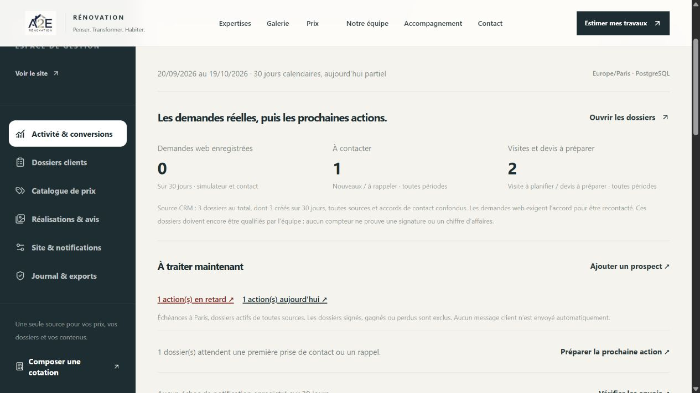

*Toujours lire la période et la source. Les demandes CRM et les sessions mesurées décrivent deux périmètres différents.*

**Activité & conversions** présente trente jours calendaires en **Europe/Paris**, avec la journée actuelle partielle. Le suivi opérationnel des statuts et échéances inclut, lui, les dossiers de toutes périodes et sources. Les liens d'actions ouvrent les files du CRM correspondantes.

| Indicateur | Ce qu'il représente |
| --- | --- |
| Demandes web enregistrées | Dossiers web sauvegardés avec accord de recontact sur la période, simulateur et contact. Ils restent à qualifier. |
| À contacter | Dossiers nouveaux ou à rappeler, toutes périodes. |
| Visites et devis à préparer | Dossiers aux statuts correspondants, toutes périodes. |
| Actions en retard / aujourd'hui | Échéances des dossiers actifs, par jour de Paris. Les dossiers clos sont exclus. |
| Parcours mesuré | Sessions ayant suivi dans l'ordre : session mesurée, simulateur démarré, budget consulté, étape contact, demande enregistrée. |
| Notifications | Tentatives du fournisseur et leur résultat technique ; ni personnes contactées ni messages lus. |

Une session appartient à un navigateur et à un onglet, pas nécessairement à une personne unique. Le parcours n'inclut que les événements pouvant être mesurés avec l'accord d'audience requis. Un formulaire enregistré sans cet accord reste dans le CRM ; il peut être absent du parcours mesuré.

**L'accord de recontact et l'accord de mesure d'audience sont distincts.** Le visiteur peut modifier sa préférence d'audience depuis le pied de page ; elle expire après six mois calendaires. Le réglage global **Suivi des visites et clics** permet aussi de désactiver la mesure. L'administration n'est pas comptée comme une visite publique dans ce suivi.

Les anciennes données peuvent ne pas contenir les événements introduits avec la V1 : une absence d'événement ne prouve pas à elle seule un abandon. Si le dénominateur manque, un ratio est indisponible. Si la base est indisponible, l'interface indique le problème au lieu de fabriquer des zéros. Aucun chiffre d'affaires, objectif de conversion ou retour sur investissement n'est déduit automatiquement.

Pour agir, chercher d'abord une friction : demandes sans prochaine action, rappels en retard, passage budget → contact peu fréquent sur un volume suffisant, ou erreurs de notification. Vérifier les dossiers et la période avant de modifier l'offre. Les exemples locaux ne doivent jamais servir de résultat commercial.

### Journal et exports

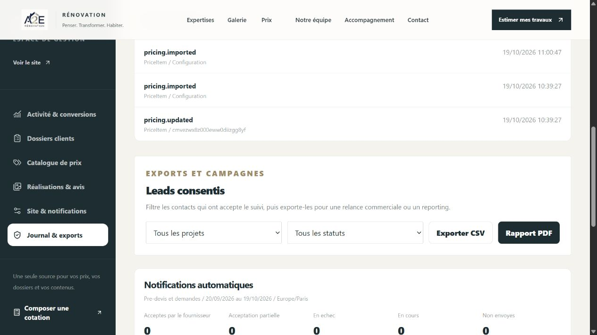

*Les exports fournissent une sélection de dossiers. Ils ne remplacent pas la sauvegarde complète de l'application.*

**Journal & exports** affiche les quinze dernières actions d'audit chargées : action, entité, identifiant et date à Paris. Les notes et échanges détaillés se consultent dans le dossier CRM. Ce journal d'interface n'est pas un export intégral de tous les événements techniques.

La zone **Leads consentis** permet de filtrer par métier et par statut proposé puis de télécharger :

- **CSV** : date, nom, email, téléphone, zone, projet, statut, accord et dernier montant bas/central/haut lorsqu'il existe. Sans estimation, les montants restent vides ou reprennent le budget explicitement saisi ; le fichier ne contient pas tout l'historique des échanges ni toutes les descriptions libres.
- **Rapport PDF** : synthèse du nombre de dossiers et de leur répartition par projet, avec une liste limitée des derniers dossiers. Il s'agit d'un rapport de lecture, pas du registre complet du CRM.

Sans filtre de dates saisi par un outil technique, ces boutons portent sur tout l'historique correspondant et ne reprennent pas automatiquement la période du dashboard. Ils ne reprennent pas non plus les filtres de recherche du CRM. Vérifier la sélection affichée dans la rubrique d'export.

Ces fichiers contiennent des données personnelles : les conserver dans l'espace professionnel autorisé. **Exporter n'envoie aucune campagne.** Le fichier CSV ne sauvegarde ni les cotations, ni les activités complètes, ni les paramètres, ni les photos.

### Sauvegarde complète

La sauvegarde d'exploitation associe la base PostgreSQL et le volume des médias. Elle doit aussi permettre de retrouver la configuration privée de l'hébergement dans un endroit sécurisé. Un export de contacts, un catalogue CSV, un JSON de cotation et un brouillon navigateur ont chacun un rôle utile, mais aucun ne suffit à restaurer seul tout le site.

Le lien **Ouvrir le healthcheck** affiche la disponibilité de l'application et de ses ressources vérifiées. Il ne prouve ni qu'une sauvegarde récente existe, ni que le SMTP fonctionne, ni qu'une restauration a été testée. L'opérateur suit la procédure Docker et teste la restauration vers de nouveaux volumes avant de remplacer des données.

## 11. Routines d'exploitation

### Chaque jour d'activité

1. Lire les nouvelles demandes et les préférences de rappel.
2. Ouvrir les actions en retard puis celles d'aujourd'hui.
3. Qualifier chaque dossier, enregistrer le compte rendu et fixer une prochaine action.
4. Vérifier les notifications en échec, partielles ou en attente sans réexpédier à l'aveugle.
5. Contrôler les cotations à vérifier avant de les transmettre.

### Chaque semaine

1. Lire les trente jours de KPI avec leur périmètre ; comparer les volumes utiles plutôt qu'un pourcentage isolé.
2. Repérer les dossiers actifs sans action et les demandes restées sans réponse.
3. Revoir les références de prix réellement utilisées : achat, pose, exclusions, TVA et marge.
4. Préparer une réalisation avec photos autorisées et un avis réellement recueilli.
5. Vérifier qu'une sauvegarde base + médias existe et que la procédure de restauration reste utilisable.

### Après une mise à jour d'hébergement

Ouvrir la vitrine, le simulateur et l'admin sur l'URL réelle. Vérifier les données existantes, une connexion/déconnexion, la lecture d'un prix, une sauvegarde puis relecture autorisée et la présence des photos. Contrôler le PDF et un envoi email autorisé. Les tests locaux de la livraison ne remplacent pas cette vérification derrière le domaine et le proxy de production.

Ne pas lancer un seed de démonstration pour effectuer une mise à jour. Les exemples locaux de prospects et d'inspirations ne sont pas importés automatiquement dans la base de production.

## 12. Dépannage et périmètre V1

| Situation | Action utile |
| --- | --- |
| Connexion admin refusée | Vérifier l'identifiant de cet hébergement, les variables privées, le domaine HTTPS et l'heure du serveur avec l'opérateur. Après échecs répétés, respecter la limitation temporaire. |
| Sauvegarde envoyée, relecture non confirmée | Conserver la saisie, relire la valeur enregistrée, comparer puis recommencer uniquement ce qui manque. |
| Conflit 409 dans un dossier ou les avis | Recharger la version actuelle et réappliquer les modifications utiles sans écraser la version récente. |
| Tarif manquant dans le simulateur | Vérifier le catalogue de la base cible et l'import des références attendues. Proposer une étude sur mesure si la configuration sort du référentiel. |
| Import CSV refusé | Contrôler encodage, en-têtes, clés, séparateur, limite de taille, unités, TVA et ordre des trois prix. Ne pas renommer un PDF en CSV. |
| Prix différent dans une ancienne cotation | Les valeurs y ont été copiées lors de la préparation. Corriger le document explicitement si nécessaire. |
| PDF public indisponible après enregistrement | Utiliser le nouveau téléchargement sur l'écran courant ou transmettre la référence du dossier à A2E. |
| Notification absente | Lire événement, canal sélectionné et journal ; vérifier variables, fournisseur, quotas et boîte destinataire. Une configuration présente ne garantit pas la réception. |
| Galerie publique vide | Vérifier la publication des fiches, la présence d'une photo, le volume de médias et les données de la base réellement utilisée. |
| Comparaison avant/après absente | Vérifier les deux rôles photo et la confirmation du même espace. Une vidéo ne peut pas remplir l'un de ces rôles. |
| Envoi de média refusé | Vérifier format et 50 Mo maximum, puis limite du proxy, espace et droits du volume de médias avec l'opérateur. |
| KPI vides malgré des dossiers | Distinguer période, origine, accord de mesure et CRM. Contrôler si une panne est signalée avant de conclure à une absence d'activité. |
| Portainer signale `A2E_IMAGE_TAG` manquant | Le Compose exige le tag d'une image publiée. Renseigner la variable de la stack avant **Pull and redeploy**, en conservant les volumes et secrets. Suivre le guide opérateur ; ce message ne demande pas de réinitialiser la base. |

### Ce que la V1 permet déjà

Présenter les métiers, estimer plusieurs lots avec quantités et matériel, recueillir une demande sur mesure avec rappel, préparer un PDF, tenir un catalogue modifiable, enregistrer des cotations, suivre les dossiers et leurs échéances, publier des médias et des avis autorisés, notifier plusieurs boîtes et lire les indicateurs réellement disponibles.

### Ce qui nécessite une action humaine ou une configuration

La validation des prix, des métrés, des taux et des références ; l'étude technique et les aides ; l'appel et le rendez-vous ; la transmission commerciale d'une cotation ; les accords de publication ; le compte email et son contrôle de réception ; le déploiement, les sauvegardes et la restauration.

### Ce qui n'est pas une fonction livrée dans la V1

Campagnes de relance CRM automatiques, lecture OCR de devis fournisseurs, génération automatique d'images depuis l'admin, portail personnel client, comptes d'équipe avec rôles distincts, synchronisation d'agenda, signature électronique, facturation, encaissement et import automatique d'une base de prix professionnelle sous licence. Les liens, statuts et exports existants ne doivent pas être présentés comme ces services.

## Références de fonctionnement

- [Catalogue 77, sources, périmètres et hypothèses](../catalogue-77-2026-10.md)
- [Atelier de cotation, montants et transferts CSV/JSON](../quote-workspace.md)
- [CRM : données, échéances et conflits](../crm-prospection.md)
- [Définitions des KPI d'acquisition](../kpi-acquisition-qualifiee.md)
- [Notifications email et limites d'automatisation](../notifications-email.md)
- [Gestion des avis et preuve d'accord](../customer-reviews.md)
- [Guide de prises de vue et médias](../guide-photos-chantiers.md)
- [Migration, sauvegarde et restauration Docker](../migration-docker-premium.md)

**Référence de cette édition :** fonctions vérifiées dans les sources V1 du dépôt actif `A2E`, le 19 octobre 2026. La configuration et les données propres à l'hébergement restent à contrôler sur cet hébergement.
